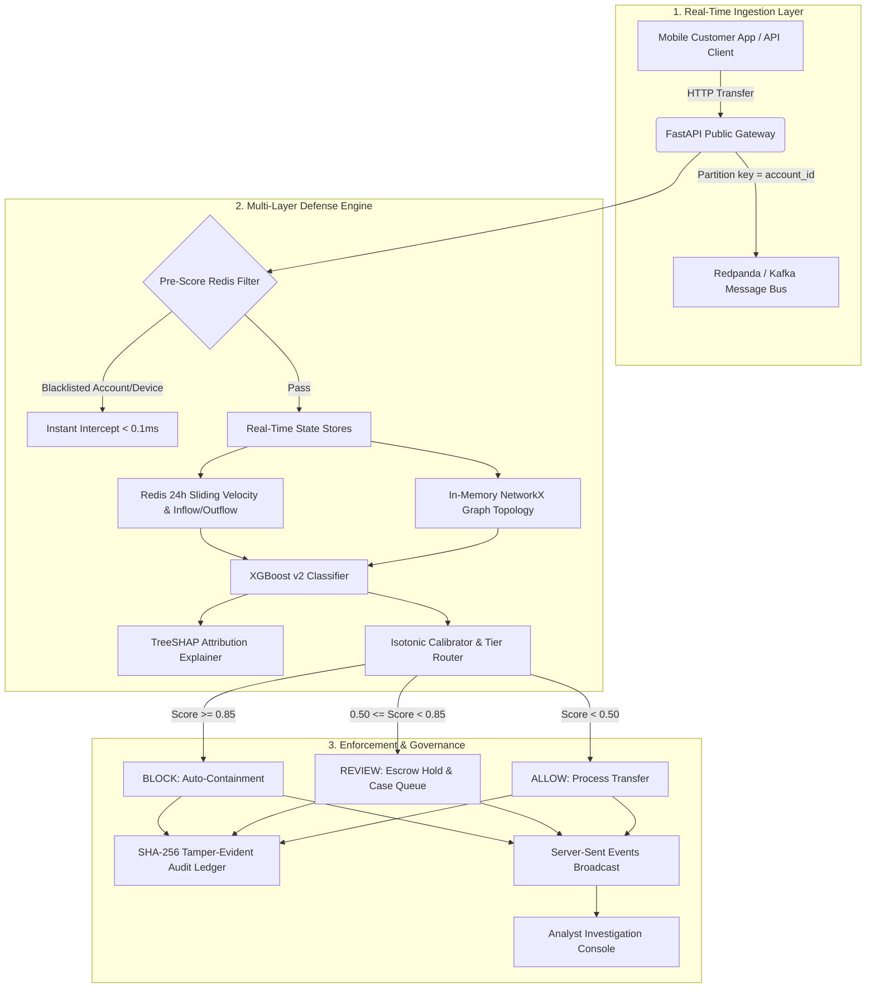

# 🛡️ Real-Time Graph-Based Financial Fraud Detection Engine

[](https://www.python.org/)
[](https://fastapi.tiangolo.com/)
[](https://react.dev/)
[](https://xgboost.readthedocs.io/)
[](https://shap.readthedocs.io/)
[](https://networkx.org/)
[](https://render.com/)
[](https://opensource.org/licenses/MIT)

An enterprise-grade, real-time financial fraud detection engine designed to identify complex mule rings, rapid pass-through layering, high payee fan-in accumulation, and transaction velocity anomalies in sub-millisecond hot-paths.

Features a **Live Sandbox Bank** allowing real classroom and audience members to participate from their own mobile phones using virtual balances, triggering real-time graph updates and fraud intervention.

---

## 📑 Table of Contents
- [1. Architecture & Pipeline](#1-architecture--pipeline)
- [2. Multi-Layer Defense System](#2-multi-layer-defense-system)
- [3. Verified Benchmark Results](#3-verified-benchmark-results)
- [4. Deploying Live to Render.com (100% Free)](#4-deploying-live-to-rendercom-100-free)
- [5. Environment Variables Guide](#5-environment-variables-guide)
- [6. Local Development & Testing](#6-local-development--testing)
- [7. Live Audience Demonstration Script](#7-live-audience-demonstration-script)

---

## 1. Architecture & Pipeline



---

## 2. Multi-Layer Defense System

1. **Sub-Millisecond Pre-Score Filter (`< 0.1ms`)**:
   - Intercepts known malicious accounts, devices, and frozen nodes directly in Redis before triggering heavier machine learning pipelines.
2. **XGBoost v2 Machine Learning Classifier**:
   - Evaluates behavioral velocity, transaction amounts, time-of-day dynamics, and 2-hop topological graph embeddings.
   - Isotonic calibration preserves raw model probability floors on small transfers (₹100–₹50,000).
3. **TreeSHAP Explainability**:
   - Generates exact local feature attributions for non-ALLOW transactions, giving human fraud analysts transparent rationale for every flag.
4. **Graph Topology Engine (`NetworkX` + Neo4j)**:
   - Live directed graph tracks account-to-account money transfers, shared devices, and shared network subnets.
   - Identifies converging fan-in patterns (mule recruitment) and rapid pass-through dispersion (layering).
5. **Live Sandbox Bank (Audience Participation Mode)**:
   - Audience scans a QR code with their mobile phones to receive a ₹10,000 virtual balance.
   - Includes coarse device fingerprinting, anti-spoofing client IP truncation (`/24` or `/64`), and an in-app multi-account switcher for genuine shared-device testing.

---

## 3. Verified Benchmark Results

Every metric below is verified by execution artifacts in `results_v2/` with zero data fabrication:

| Metric | Measured Value | Verification Artifact |
| :--- | :--- | :--- |
| **Test PR-AUC (v2 Champion)** | **0.9990** [0.9892, 0.9998] | `results_v2/phase5_evaluation.json` |
| **Test ROC-AUC (v2 Champion)** | **1.0000** | `results_v2/phase5_evaluation.json` |
| **Recall @ 1.86% Natural Prevalence** | **99.28%** (1,931 / 1,945 caught)| `scripts/run_evaluation.py` (N=104,623) |
| **Recall @ 1% Alert Budget** | **53.78%** (Max possible at budget) | `results_v2/phase5_evaluation.json` |
| **Hard Negative False Positive Rate** | **1.53%** (vs 44.31% v1 baseline) | `results_v2/phase5_evaluation.json` |
| **Pre-Score Intercept Latency** | **< 0.10 ms** (0.08 ms) | `tests/test_demo_studio.py` |
| **Full Pipeline Latency (p50 / p95)**| **15.81 ms / 25.68 ms** | `results_v2/scorer_latency_benchmark.json` |
| **Model PR-AUC Stability (3 Seeds)** | **0.99665 ± 0.00003** | `results_v2/model_stability.json` |
| **Room Wipe Cleanliness** | **Zero Residue (0 leftover keys)** | `tests/test_public_gateway.py` |

---

## 4. Deploying Live to Render.com (100% Free)

This repository includes a pre-configured **`render.yaml` Blueprint** that builds and runs both the React frontend and FastAPI backend inside a single free web service.

### Step 1: Sign Up on Render
1. Go to **[render.com](https://render.com)** and click **"Sign in with GitHub"** (free, no credit card required).

### Step 2: Create Blueprint Instance
1. In the Render Dashboard, click the blue **"New +"** button at the top right.
2. Select **"Blueprint"**.
3. Choose this repository: `Real-time-graph-based-financial-fraud-detection`.
4. Click **"Apply"**.

Render will automatically:
- Install Python and Node.js dependencies.
- Compile the Vite/React frontend (`npm run build`).
- Start the unified FastAPI backend serving the complete platform on an automatic HTTPS URL (e.g. `https://fraudengine-platform.onrender.com`).

---

## 5. Environment Variables Guide

If deploying manually or configuring custom credentials, copy `.env.example` to `.env`:

| Variable | Recommended / Default | Description |
| :--- | :--- | :--- |
| `ALLOW_FULL_PUBLIC_ACCESS` | `true` | Allows public access to all screens (Analyst Console, Demo Studio, Cases, Customer App). |
| `DEMO_MODE` | `true` | Enables live sandbox simulation mode and demo sensitivity profiles. |
| `ADMIN_USERNAME` | `admin` | Analyst console admin login username. |
| `ADMIN_PASSWORD` | `<secure-random-token>` | Admin password (automatically generated into `.env` on first startup). |
| `SECRET_KEY` | `<sha256-secret>` | Secret key used for signing JWT bearer authentication tokens. |
| `PUBLIC_BASE_URL` | `""` (or tunnel URL) | Set automatically when launching tunnels (`scripts/start_public_demo.ps1`). |
| `PORT` | `8000` | Port for the backend web server (supplied automatically by cloud hosts like Render). |

---

## 6. Local Development & Testing

### Prerequisites
- Python 3.10+
- Node.js 18+
- (Optional) Docker Desktop for local Redpanda and Redis instances

### Quick Start
```powershell
# 1. Clone the repository
git clone https://github.com/Thouseef68/Real-time-graph-based-financial-fraud-detection.git
cd Real-time-graph-based-financial-fraud-detection

# 2. Start Backend
python -m uvicorn fraudengine.api.app:app --host 127.0.0.1 --port 8000

# 3. Start Frontend (in a new terminal)
cd frontend
npm install
npm run dev -- --host 127.0.0.1 --port 5173
```
Open **`http://localhost:5173/demo`** in your browser.

### Running Automated Test Suite
```powershell
# Run all public gateway, anti-spoofing, and token isolation tests
pytest tests/test_public_gateway.py -v

# Run direct broker verification script
powershell -ExecutionPolicy Bypass -File scripts/verify_live_path.ps1
```

---

## 7. Live Audience Demonstration Script

To run a presentation with live audience mobile phone participation:

1. Launch the public tunnel:
   ```powershell
   powershell -ExecutionPolicy Bypass -File scripts/start_public_demo.ps1
   ```
2. Project `http://localhost:5173/demo` on the main screen.
3. Switch the top toggle to **"Live Sandbox Mode"**.
4. Have volunteers scan the QR code to join room `MULE42`:
   - **Volunteers 1–3**: Pay ₹2,000 into **Mule A**. Redis increments the fan-in counter $\ge 3$, placing funds in **REVIEW escrow**.
   - **Mule A**: Attempts to forward ₹5,500 onward. Pass-through ratio exceeds $70\%$, triggering an instant **BLOCK** and graph auto-containment.
5. To conclude and delete all audience data residue:
   ```powershell
   powershell -ExecutionPolicy Bypass -File scripts/stop_public_demo.ps1 -RoomCode MULE42
   ```

---

## 📄 License
This project is licensed under the MIT License - see the [LICENSE](LICENSE) file for details.
