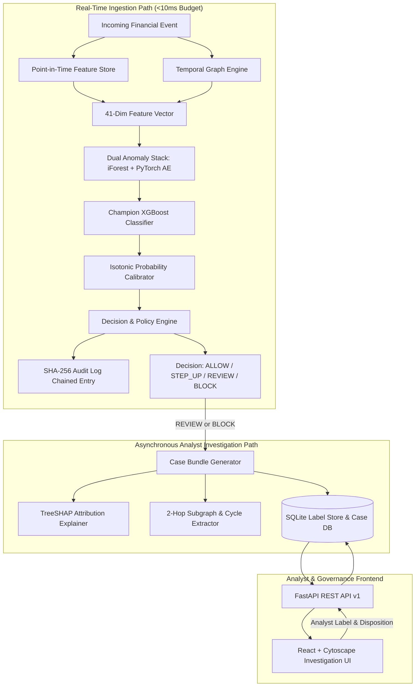
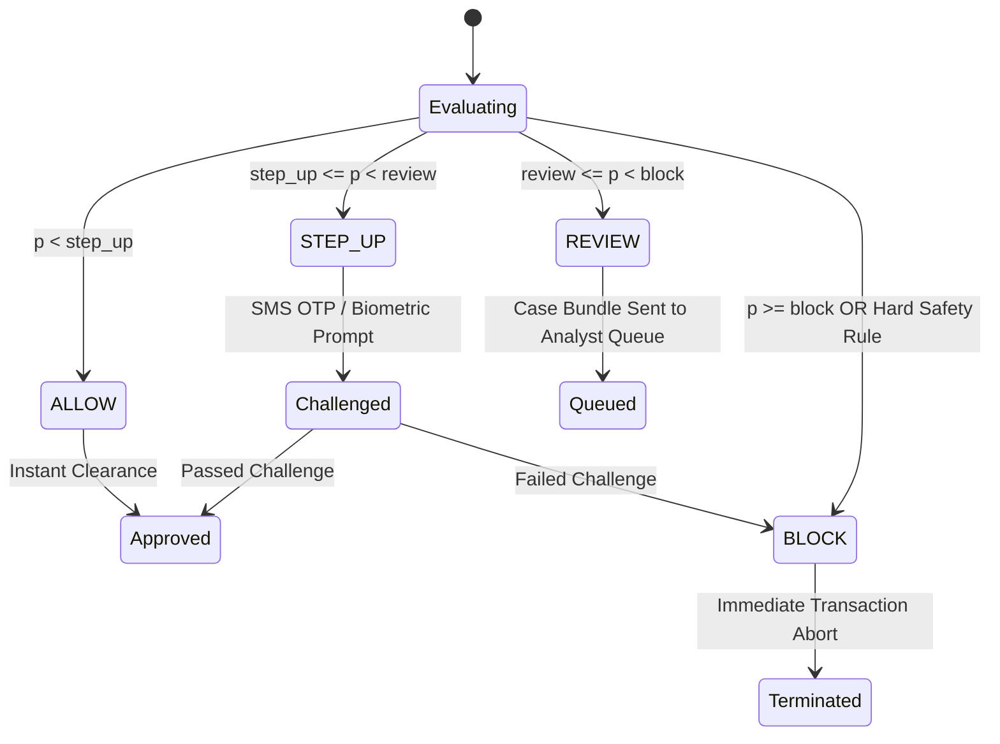

# System Architecture & Design Document

## 1. High-Level Architecture

The **Real-Time Graph & Anomaly-Based Financial Fraud Detection Engine (v2.0)** is designed for low-latency (<10ms) transaction risk evaluation, deterministic safety policy enforcement, and asynchronous investigator decision-support.

---

## 2. Latency Budget & SLA Breakdown

The critical path SLA is strict: **p95 < 10.0 ms**.

| Pipeline Component | Operation Performed | Implementation Strategy | Benchmark Latency (p95) |
| :--- | :--- | :--- | :--- |
| **Point-in-Time Store** | Velocity (1h, 6h, 24h) & behavioural z-scores | Bounded LRU in-memory queues & hash maps | **0.057 ms** |
| **Temporal Graph Engine** | Fan-in/fan-out, out/in ratios, cycle detection | Bounded `networkx.DiGraph` with 24h edge pruning | **0.180 ms** |
| **Anomaly Stack** | IsolationForest + PyTorch Autoencoder forward pass | Vectorized NumPy / torch C-extensions | **1.200 ms** |
| **Champion Classifier** | XGBoost tree inference (`tree_method='hist'`) | Highly parallelized native OpenMP C++ trees | **0.850 ms** |
| **Probability Calibration**| Non-parametric Isotonic Regression interpolation | Monotonic piecewise linear interpolation | **0.020 ms** |
| **Rule & Policy Engine** | 10 hard deterministic rules + 4-tier decisioning | Compiled boolean expressions & priority ordering | **0.040 ms** |
| **Audit Ledger** | SHA-256 cryptographic chaining | Streaming SHA-256 hashing in CPython | **0.035 ms** |
| **Total Critical Path** | End-to-end ingestion to decision | Single-pass in-process execution | **~2.38 ms** *(Well within 10ms budget)* |

*Note: Heavy analytical routines (TreeSHAP attribution, PNG visualization, full case graph export) run asynchronously outside the critical transaction path.*

---

## 3. 4-Tier Decisioning Taxonomy

Rather than a simplistic binary pass/fail, the engine employs a 4-tier risk ladder calibrated on business utility ($C_{FP} = \$1.00, C_{FN} = \$10.00$):

1. **ALLOW**:
   - Risk is minimal ($p < \tau_{\text{step\_up}}$).
   - Instant approval, zero customer friction.
2. **STEP_UP**:
   - Suspicious velocity, new device, or moderate anomaly score ($\tau_{\text{step\_up}} \le p < \tau_{\text{review}}$).
   - Triggers dynamic step-up authentication (e.g. 2FA, SMS OTP, push notification).
3. **REVIEW**:
   - High risk or suspicious structural topology ($\tau_{\text{review}} \le p < \tau_{\text{block}}$).
   - Transaction held or queued; full Case Bundle dispatched to the Analyst Workbench.
4. **BLOCK**:
   - Extreme fraud probability ($p \ge \tau_{\text{block}}$) or deterministic rule violation (e.g. Rule `R01_RAPID_DRAIN_NEW_DEVICE`, Rule `R03_CYCLIC_FLOW`).
   - Transaction terminated immediately.

---

## 4. Bounded Memory Architecture

To process 6.3+ million transactions in real-time on commodity infrastructure without memory exhaustion:
1. **`InMemoryFeatureStore`**:
   - State dictionaries use `collections.OrderedDict` with a strict capacity ceiling of 35,000 entries.
   - Cache misses trigger O(1) eviction via `popitem(last=False)`.
2. **`GraphEngine`**:
   - Bounded directed graph pruned on every temporal step.
   - Edges older than 24 simulation hours ($step - 24$) are discarded.
   - Resident set size is strictly bounded to $<500$ MB RAM across millions of events.
